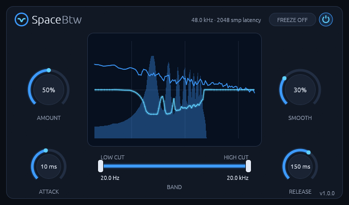

# SpaceBtw

> **Discontinued** since 7 Nov 2026: SpaceBtw gets no new releases. v1.0.6, the last one, stays
> here to download and keeps working.

**A sidechain spectral ducker for Linux:** it turns a track down only at the frequencies the
sidechain signal is using right now.
CLAP and VST3 for Linux.



Put SpaceBtw on a pad, a guitar bus or a bass, and feed the vocal, lead or kick into its
sidechain input. Wherever the sidechain has energy, the matching frequencies of the track dip, by
up to 24 dB, and everything else is left alone. The vocal gets its own space in the mix without
the whole pad pumping, as it would under a full-band sidechain compressor.

It runs natively on Linux, with no network access and no telemetry.

**[Read the manual](manual.md)** for every control and how to use it.

## Features

- **Spectral, not full-band:** up to 2049 frequency bins, each cut by how loud the sidechain is there.
- **Level-independent:** a quiet and a loud vocal carve the same shape.
- **Freeze:** holds the current cut shape, even after the sidechain stops.
- **Live spectrum:** shows the track, the sidechain and the cut.
- **Transparent when idle:** at AMOUNT 0, switched off or without a sidechain, the output is a bit-exact delayed copy of the input.
- **Cheap:** about 0.6% of one core for a stereo instance at 48 kHz with every bin cutting.

## Install

Download the latest version from the [Releases page](https://github.com/rmnhofma/SpaceBtw-release/releases),
or with these commands:

```bash
curl -LO https://github.com/rmnhofma/SpaceBtw-release/releases/download/v1.0.6/SpaceBtw-1.0.6-linux-x86_64.tar.gz
curl -LO https://github.com/rmnhofma/SpaceBtw-release/releases/download/v1.0.6/SpaceBtw-1.0.6-linux-x86_64.tar.gz.sha256
sha256sum -c SpaceBtw-1.0.6-linux-x86_64.tar.gz.sha256 && tar xzf SpaceBtw-1.0.6-linux-x86_64.tar.gz
cd SpaceBtw-1.0.6-linux-x86_64
```

Install for your user:

```bash
mkdir -p ~/.clap ~/.vst3
rm -f ~/.clap/SpaceBtw.clap && cp SpaceBtw.clap ~/.clap/
rm -rf ~/.vst3/SpaceBtw.vst3 && cp -r SpaceBtw.vst3 ~/.vst3/
```

Or for all users:

```bash
sudo mkdir -p /usr/lib/clap /usr/lib/vst3
sudo rm -f /usr/lib/clap/SpaceBtw.clap && sudo cp SpaceBtw.clap /usr/lib/clap/
sudo rm -rf /usr/lib/vst3/SpaceBtw.vst3 && sudo cp -r SpaceBtw.vst3 /usr/lib/vst3/
```

Removing the old copy first avoids overwriting a file a running host has loaded. Then rescan plugins
in your DAW.

To uninstall:

```bash
rm -rf ~/.clap/SpaceBtw.clap ~/.vst3/SpaceBtw.vst3
```

## Requirements

- Linux x86-64 with glibc 2.31 or newer (Ubuntu 20.04, Debian 11, Fedora 32 and newer)
- A CLAP or VST3 host
- X11 or XWayland, and a Vulkan driver for the editor

Releases contain the CLAP and VST3 plugins only.

## License

MIT, see [LICENSE](LICENSE). The licenses of the third-party code in the binaries are in
`THIRD-PARTY-LICENSES.txt` in each release archive.

VST is a registered trademark of Steinberg Media Technologies GmbH. CLAP is an open standard
by the free-audio project. SpaceBtw is an independent project, not affiliated with or endorsed by
Steinberg.
