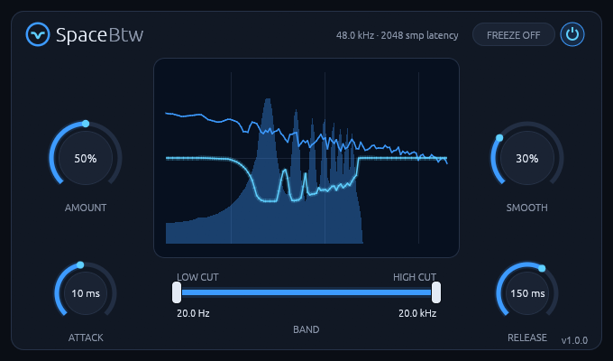

# SpaceBtw manual

**A sidechain spectral ducker for Linux:** it turns a track down only at the frequencies the
sidechain signal is using right now.

Version 1.0.6. To install it, see the [README](README.md).

## Getting started

1. Put SpaceBtw on the track that should **make room**: a pad, a guitar bus, a bass.
2. Route the track that should **get the room** into its sidechain input (see below).
3. Play both. Raise AMOUNT until the part sits where you want it.

The status line shows `no sidechain` while nothing arrives. It's the first thing to check if you
hear no effect.

## Routing the sidechain

SpaceBtw has a stereo main input and a stereo auxiliary input named **Sidechain**.

- **Bitwig Studio:** open the device's sidechain selector in its header and pick the source track.
- **REAPER:** on SpaceBtw's track, open the routing window and set the track to 4 channels. On the
  source track, add a send to SpaceBtw's track from channels 1/2 to 3/4. The plugin's pin connector
  maps 3/4 to the Sidechain input.
- **Ardour:** right-click the plugin in the mixer strip, open **Pin Connections**, add a sidechain
  input if it isn't there, and connect the source track to it.
- **Carla:** connect the source to the plugin's `sidechain` ports in the patchbay.

## The controls

| Control | Range | Default | What it does |
| --- | --- | --- | --- |
| **Power switch** (top right) | On / Off | On | Crossfades (10 ms) between the processed signal and the dry signal, which stays delayed so it stays in time. |
| **Freeze** (top right) | On / Off | Off | Holds the current cuts. |
| **Amount** | 0 to 100% | 50% | Depth of the cuts, as a share of 24 dB. |
| **Smooth** | 0 to 100% | 30% | Spreads the sidechain over frequency, from none to one octave. |
| **Attack** | 1 to 200 ms | 10 ms | How fast a cut deepens. |
| **Release** | 10 to 1000 ms | 150 ms | How fast a cut recovers. |
| **Band** | 20 Hz to 20 kHz | Fully open | LOW CUT and HIGH CUT limit where cuts happen. They stay at least 1.25× apart, with soft 1/3-octave edges. |

**Mouse:** drag a knob up or down, and hold Shift for fine control. Double-click a knob to
reset it. Every control is also a host parameter you can automate.

The status line shows the sample rate and latency. The version is in the bottom-right corner, and
clicking the logo opens [the plugin's page](https://rmnhofma.github.io/plugins/spacebtw/).

## How to use it

### Amount and Smooth: how much, and how wide

AMOUNT sets how deep the cuts can go. SMOOTH sets their shape: low values follow the sidechain
closely with narrow dips, high values spread each dip over up to an octave. Broad, soft dips bring
fewer artifacts, so raise SMOOTH if the track starts to sound hollow or watery.

### Attack and Release: how it moves

These work like a compressor's. ATTACK is how quickly a cut deepens, RELEASE how quickly it comes
back. A short RELEASE lets the track return between words or hits. A long one keeps the space open
and moves less.

### Band: where it may cut

Use LOW CUT and HIGH CUT to protect part of the track. If a vocal should only make room in the
mids, bring both handles in, and the track's lows and highs stay untouched whatever the vocal does.

### Freeze: keep a shape

FREEZE holds the current cuts, even after the sidechain stops. Frozen cuts keep applying without a
sidechain, because you asked for them. Releasing FREEZE fades back to the live cuts. Use it to make
a static EQ-like carve out of a moment of the sidechain.

### Stereo

The left channel is cut from the sidechain's left and the right from its right, so a panned source
carves on its own side. A mono sidechain drives both.

## Good to know

- **Latency:** 2048 samples (43 ms at 48 kHz, 11 ms at 192 kHz), reported to the host, which
  compensates for it. The track stays delayed by this amount even while nothing is being cut, so it
  stays in time with the rest of the mix.
- **Level:** the cut follows the sidechain's level relative to its own recent peak: no cut at 50 dB
  below that peak, the full cut at 10 dB below. So turning the sidechain track up or down doesn't
  change the shape.
- **Audio:** stereo, 44.1 to 192 kHz, any block size.
- **Hosts:** the CLAP passes `clap-validator`, and the VST3 passes `pluginval` at strictness 10.
- **Display:** X11, or XWayland on a Wayland desktop, with a Vulkan driver.

## Troubleshooting

- **No effect, and the status line says `no sidechain`:** the sidechain input has been silent for
  a second or isn't connected. Check the routing above, and that the source track is playing.
- **The plugin doesn't show up:** check that the bundle is in `~/.clap`, `~/.vst3`,
  `/usr/lib/clap` or `/usr/lib/vst3`, then rescan plugins in your DAW.
- **The editor window stays black or doesn't open:** check that a Vulkan driver is installed.
  The `vulkaninfo` tool from `vulkan-tools` should list your GPU. Bitwig Studio writes plugin
  errors to `~/.BitwigStudio/log/engine.log`.
